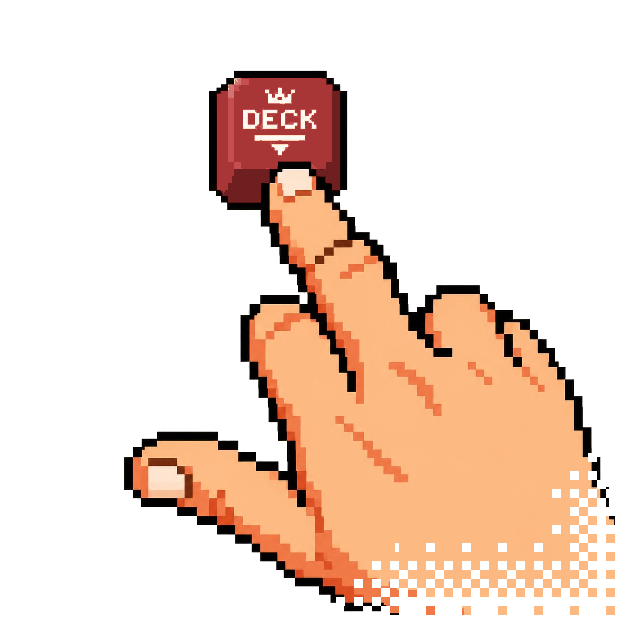

<p align="center">
  <picture>
    <source media="(prefers-color-scheme: dark)" srcset="assets/decktech-logo-dark.webp 1x, assets/decktech-logo-dark@2x.webp 2x">
    <source media="(prefers-color-scheme: light)" srcset="assets/decktech-logo-light.webp 1x, assets/decktech-logo-light@2x.webp 2x">
    
  </picture>
</p>

<h1 align="center">DeckTech</h1>

<p align="center"><a href="README.md">English</a> | <a href="README.pt-BR.md">Português (Brasil)</a> | <a href="README.es.md">Español</a> | <a href="README.ru.md">Русский</a> | <strong>简体中文</strong></p>

DeckTech 可以把 Mac 或 Windows 电脑变成远程应用 Dock 的主机。应用会启动一个本地 Node.js 服务器，并通过 Android APK、iPhone 上的 PWA 或浏览器，向同一网络中的设备提供界面。
使用 DeckTech PRO，手机还可以通过 Home Assistant 和 Philips Hue（Beta）控制家居。

本指南适用于 DeckTech v0.1.1。

这个公开仓库只包含文档、社区支持和官方发布版本。DeckTech 是专有软件，源代码不会公开。

责任方与许可方：Produtora MaxVision, São Paulo/Brasil.

> 本文是英文文档的简体中文译文。DeckTech 目前的界面只有葡萄牙语（巴西）和英语，没有中文界面。在 Windows 上，主机窗口在当前版本中只有葡萄牙语；在 macOS 上，主机提供语言选择器（Português/English）；Android 应用和 PWA 在设备语言以“pt”开头时使用葡萄牙语，其他情况使用英语。因此，在中文设备上，除 Windows 主机窗口为葡萄牙语外，你看到的都是英文界面。本文中的按钮、标签页和菜单名称均按应用实际显示的文字书写。

## 下载

| 平台 | 直接下载 |
|---|---|
| Windows 10 或 11（64 位，x64，版本号 10240 或更高） | [`DeckTech-Setup.exe`](https://github.com/produtoramaxvision/DeckTech/releases/latest/download/DeckTech-Setup.exe) |
| Android 5.0+ | [`decktech.apk`](https://github.com/produtoramaxvision/DeckTech/releases/latest/download/decktech.apk) |
| macOS 14+ | [`DeckTech-macOS.dmg`](https://github.com/produtoramaxvision/DeckTech/releases/latest/download/DeckTech-macOS.dmg) |

你也可以查看[最新发布版本](https://github.com/produtoramaxvision/DeckTech/releases/latest)和 [`SHA256SUMS.txt`](https://github.com/produtoramaxvision/DeckTech/releases/latest/download/SHA256SUMS.txt)。切勿安装调试版（Debug）APK，也不要安装通过非官方渠道获得的文件。

## 使用 AI 代理安装

将以下提示词粘贴到你的编程或桌面代理中，让它帮助安装 DeckTech 并说明使用方法。
代理必须在修改前征得你的同意，密码输入和安全确认由你本人完成。

```text
Help me install and set up DeckTech. Respond in my language and ask before each step that changes my system. Detect my OS: Windows 10/11, 64-bit x64, build 10240 or later, or macOS 14 or later; stop if unsupported. Read the README and manual from the official produtoramaxvision/DeckTech GitHub repository, and follow their documented installation steps without inventing command flags. Download release files ONLY from https://github.com/produtoramaxvision/DeckTech/releases/latest: DeckTech-Setup.exe for Windows, DeckTech-macOS.dmg for macOS, decktech.apk only if I want Android, SHA256SUMS.txt, and optionally DeckTech-macOS.dmg.sha256. Verify each artifact's SHA-256 against SHA256SUMS.txt BEFORE running or opening it; stop if a checksum is missing or differs. On Windows, run the installer; if SmartScreen appears, let me confirm the official source and matching hash and select More info / Run anyway only if I accept the risk. On macOS, open the DMG and drag DeckTech to Applications; let me Control-click DeckTech, choose Open and confirm; if Gatekeeper blocks it, try once and use System Settings > Privacy & Security > Security > Open Anyway. Never ask for, receive or type passwords; never disable security software or run as administrator beyond what the installer itself asks. Leave password entry and security confirmations to me. Guide first use in order: open DeckTech, let me read and accept the licence, pair my phone using the QR code / six-digit access code on the same Wi-Fi, pin my first apps, optionally connect OBS with me entering its password privately, optionally activate PRO with me entering my licence privately, and show me the manual in the same repository. Explain each step and stop for my approval before changes.
```

## 安装与首次运行

### Windows

1. 下载并运行 `DeckTech-Setup.exe`。
2. 当前的安装程序未经代码签名。如果出现 Microsoft Defender SmartScreen，请确认文件来自本仓库且 SHA-256 一致；只有在你接受风险时，才选择 **More info** 和 **Run anyway**。如果 Windows 使用其他语言，SmartScreen 会显示这些名称的译文。
3. 首次启动时，DeckTech 会显示许可协议（EULA）：勾选同意复选框以启用 **Accept and start**，或选择 **Decline and quit** 关闭应用。拒绝的选择不会被记住：下次启动时会再次显示协议，应用会保持已安装状态，直到你在 **Settings > Apps** 中将其卸载。当系统语言为葡萄牙语时，按钮文字为葡萄牙语（**Aceitar e começar** / **Recusar e sair**）。
4. DeckTech 需要 Windows 10 或 11（64 位，x64，版本号 10240 或更高）；安装程序会拒绝更早的版本和 32 位 Windows。在当前版本中，Windows 上的主机界面只有葡萄牙语：其 **Conectar**（Connect）标签页会显示本地地址和六位数的访问码——只有当电脑连接到局域网（Wi-Fi 或以太网）时才会显示地址，仅连接 VPN 不算。

### macOS

1. 下载 `DeckTech-macOS.dmg`，打开后将 DeckTech 拖到 **Applications**。
2. 该应用使用 ad-hoc 签名，未经公证。按住 Control 键点按 **DeckTech**，选择 **Open** 并确认。如果 Gatekeeper 阻止运行，请先尝试打开一次，然后使用 **System Settings > Privacy & Security > Security > Open Anyway**。这些 macOS 名称会以你的系统语言显示。
3. 首次启动时，请接受主窗口之前显示的许可协议（EULA）。
4. 打开 **Connect** 标签页查看本地地址和访问码。与 Windows 不同，macOS 应用在同一标签页中提供语言选择器（Português/English），其文字会随你在此选择的语言而变化。

### Android

1. 从本仓库下载 `decktech.apk`，Android 提示时允许从浏览器安装。
2. 首次启动时，接受应用中显示的许可协议（EULA）。
3. 在 Windows 或 macOS 主机上，打开 **Connect > Android app**（在 Windows 上为 **Conectar > App Android**），用手机相机扫描二维码。此后，APK 只信任该电脑的 HTTPS 证书。电脑和手机必须位于同一局域网（LAN）或同一 Tailscale 网络中；指向其他位置的配对链接会因安全原因被拒绝（参见 [SUPPORT.zh-CN.md 中的 Troubleshooting](SUPPORT.zh-CN.md#故障排查)）。
4. 当应用通过自动发现找到电脑时，会显示一个 16 位字符的安全码（`XXXX-XXXX-XXXX-XXXX`）。只有当它与主机 **Connect** 标签页上的 **Security code**（在 Windows 上为 **Código de segurança**）逐个字符完全一致时，才确认。
5. 输入六位数的访问码。如果电脑的证书发生变化，应用会要求你再次确认。如果你在应用之外（通过相机、浏览器或其他应用）打开配对链接，DeckTech 会在连接前要求额外确认（唯一的例外是与应用已保存的连接完全相同的链接）；只有当你本人刚刚打开或扫描了该链接时才确认。

### iPhone、iPad 与浏览器

1. 在主机上，打开 **Connect > Browser**（在 Windows 上为 **Conectar > Navegador**）。
2. 在 Safari 或其他浏览器中扫描或输入本地 HTTP 地址。
3. 输入六位数的访问码。在 Safari 中，使用 **Share > Add to Home Screen** 安装 PWA。

浏览器连接在局域网中使用 HTTP。请仅在可信的局域网中使用 PWA：访问码可以控制访问，但 HTTP 无法阻止网络中的其他参与者查看或篡改流量。在 Android 上，请始终优先使用 **Android app** 二维码提供的、固定证书的 HTTPS 流程。

## OBS Studio

**OBS Commander** 面板可以切换场景、开始和停止录制与推流，并通过每个场景旁边的星标把场景固定到 Dock 中。请在运行 DeckTech 的同一台电脑上运行 OBS。

1. 在 OBS 中，打开 **Tools › WebSocket Server Settings**（OBS 会以它自己的界面语言显示这些名称）。
2. 勾选 **Enable WebSocket server**，并使用 **Server Port: 4455**。
3. 保持勾选 **Enable Authentication**，然后点击 **Show Connect Info**。
4. 复制密码，粘贴到 DeckTech 的 OBS 面板中，然后点按 **Save and connect**。

即使 OBS 的身份验证已关闭，DeckTech 也能连接，但我们建议保持开启。保存的密码只存放在主机电脑上的 `.obs-password` 文件中；API 响应和 WebSocket 数据流绝不会把它返回给手机。如果你在手机上输入密码，它会在保存时发送到主机；进行此项设置时，建议使用带 HTTPS 的 Android。该文件在 Windows 上使用仅所有者可访问的 ACL，在 macOS 上使用 `0600` 权限；DeckTech 每次启动时都会重新应用这一保护。ACL 失败会被记录到日志，管理员可以重新获取该文件的访问权限。

如果连接失败，请检查 OBS 是否已打开，以及其 WebSocket 服务器是否已启用。如果是**密码错误**，请再次从 OBS 复制当前密码并保存。如果端口不是 **4455**，请在 OBS 设置中修改。DeckTech 与 OBS 之间的连接不需要防火墙规则：它在同一台电脑上通过 `127.0.0.1` 保持本地通信（这不会改变手机与 DeckTech 之间的网络要求）。

## 核对校验和

把文件和 `SHA256SUMS.txt` 下载到同一个文件夹，然后将文件的哈希值与对应的行进行比较：

```powershell
certutil -hashfile DeckTech-Setup.exe SHA256
```

```sh
shasum -a 256 DeckTech-macOS.dmg
sha256sum decktech.apk
```

[`DeckTech-macOS.dmg.sha256`](https://github.com/produtoramaxvision/DeckTech/releases/latest/download/DeckTech-macOS.dmg.sha256) 也可以专门用于校验 DMG。

## 条款、隐私与第三方组件

- [最终用户许可协议（EULA），葡萄牙语](EULA.md)：具有法律约束力的版本；英文文本为 [EULA.en.md](EULA.en.md)，仅为方便阅读的译文。Windows 首次启动界面会同时显示两种文本（除非系统语言为葡萄牙语，否则英文在前）；如果两者不一致，以葡萄牙语文本为准。
- [隐私声明](PRIVACY.md)
- [第三方声明](THIRD_PARTY_NOTICES.md)
- [本文档的许可](LICENSE)

这些二进制文件免费提供，属于专有软件，并依据 EULA 授权。第三方许可继续适用于相应的组件。

法律和安全类文档（EULA、隐私声明和安全政策）不提供翻译：以葡萄牙语和英语文本为准（[EULA.md](EULA.md)、[EULA.en.md](EULA.en.md)、[PRIVACY.md](PRIVACY.md)、[PRIVACY.pt-BR.md](PRIVACY.pt-BR.md)、[SECURITY.md](SECURITY.md)、[SECURITY.pt-BR.md](SECURITY.pt-BR.md)），其中 EULA 以葡萄牙语文本为准。

## 支持项目

查看[支持 DeckTech 和提出合作的方式](SUPPORT_THE_PROJECT.zh-CN.md)。
资金支持是自愿的，与技术支持分开。

## 由 Produtora MaxVision 制作

Produtora MaxVision 是 DeckTech 背后的工作室，位于 São Paulo/Brasil。你也可以委托工作室承接
独立的项目和服务；请参阅[项目支持指南](SUPPORT_THE_PROJECT.zh-CN.md)。
在 [decktech.com.br](https://decktech.com.br) 了解 DeckTech。

## 支持与安全

- 可复现的缺陷：[提交 Issue](https://github.com/produtoramaxvision/DeckTech/issues/new?template=bug_report.yml)
- 想法：[发起 Discussion](https://github.com/produtoramaxvision/DeckTech/discussions/categories/ideas)
- 安装与问题：[SUPPORT.zh-CN.md](SUPPORT.zh-CN.md)
- 直接联系：[contato@decktech.com.br](mailto:contato@decktech.com.br)
- 安全漏洞：[SECURITY.md](SECURITY.md)；请勿在 Issues 中公布敏感细节

参与社区须遵守[行为准则](CODE_OF_CONDUCT.zh-CN.md)。本仓库不接受源代码 pull request；参见 [CONTRIBUTING.zh-CN.md](CONTRIBUTING.zh-CN.md)。
